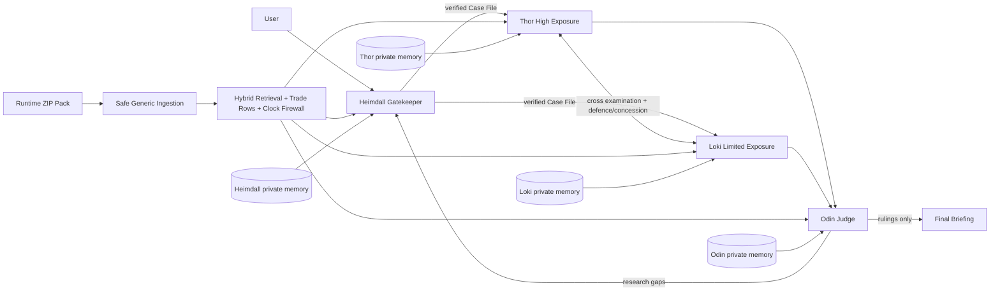

# RAGNAROK - Trial of the Nine Realms Backend

Production-oriented FastAPI backend for the **Trial of the Nine Realms** adversarial supply-chain intelligence challenge. It implements exactly four reasoning agents: **Heimdall, Thor, Loki, Odin**. The orchestration layer is deterministic Python and never acts as a fifth reasoning agent.

## Architecture



There is **no supervisor, manager, planner, chief, or LLM router**. `TrialEngine` only controls state, concurrency, limits, persistence and tracing.

## Core implementation

Runtime ingestion safely extracts uploaded ZIPs, recursively discovers PDF/TXT/DOCX, reads `manifest.json`, validates `hashes.sha256`, excludes `runemark_map.png` completely, normalizes/chunks text, generates embeddings, and parses trade-like rows into structured records. Empty, damaged, malformed and duplicate evidence is recorded instead of crashing.

Hybrid retrieval combines local semantic hashing-vector similarity, lexical overlap, exact metadata/entity bonuses, reliability weighting, metadata filters and a hard publication-date firewall. `EVENT_ID=NONE` background material is allowed while documents belonging to another event are rejected when an event filter is active. Duplicate queries are fingerprinted and blocked.

Every source placed in an LLM context is wrapped in `<UNTRUSTED_RUNEMARK_EVIDENCE>`. Agent prompts explicitly treat document instructions as hostile data. Citation validation rechecks existence, status and the simulated clock before claims are accepted.

Thor and Loki execute initial arguments concurrently with `asyncio.gather`. Cross-examination, defence/concession, Odin claim-by-claim rulings, sufficiency/retrial, multi-run storage, SSE events, Judge Mode, exposure output and reproducibility export are backend features rather than frontend timers.

## Exposure methodology

The deterministic calculator models `baseline - observed - substitution - alternative route + price/value adjustment`. It does not equate physical throughput loss with commercial value loss. Agent estimates remain separate as Thor/Loki ranges; Odin receives validated material and produces the judicial range. Missing numeric components are not silently invented.

## Storage

`FirebaseRepository` initializes Cloud Firestore when Firebase credentials are configured. The repository interface also has an in-process development fallback so ingestion/tests can run without committing credentials. For deployment, configure the Firebase variables in `.env` and replace/extend `DataRepository` persistence with the same interface for Firestore batch writes/vector indexes without changing agent logic.

Recommended Firestore hierarchy: `cases/{case_id}`, `cases/{case_id}/runs/{run_id}`, trace events, claims, challenges, rulings, briefings, `documents/{doc_id}/chunks/{chunk_id}`, trade tables/rows, isolated `agent_memories/{agent}/items`, ingestion jobs and packs.

## API

- `POST /api/v1/packs/ingest`
- `GET /api/v1/packs/{pack_id}/status`
- `POST /api/v1/cases`
- `POST /api/v1/cases/{case_id}/run`
- `GET /api/v1/cases/{case_id}`
- `GET /api/v1/cases/{case_id}/trace`
- `GET /api/v1/cases/{case_id}/briefing`
- `GET /api/v1/cases/{case_id}/exposure`
- `GET /api/v1/sources/{source_id}`
- `GET /api/v1/trade/{table_id}/rows/{row_id}`
- `GET /api/v1/cases/{case_id}/stream` (SSE)
- `GET /api/v1/cases/{case_id}/judge-mode`
- `GET /api/v1/cases/{case_id}/export`

## Installation

```bash
python -m venv .venv
source .venv/bin/activate        # Windows: .venv\\Scripts\\activate
pip install -r requirements.txt
cp .env.example .env
uvicorn app.main:app --reload --port 8000
```

Set an OpenAI-compatible `LLM_BASE_URL`, `LLM_API_KEY`, and `LLM_MODEL`. The model must support JSON-schema structured responses. Embeddings default to a deterministic local hashing provider, preserving the `EmbeddingProvider` abstraction.

## Demo flow

1. Upload the supplied or unseen event-pack ZIP to `/packs/ingest`.
2. Create a case with question, `as_of_date`, pack ID, countries and sectors.
3. Run the case. Heimdall verifies it first. A false event stops the trial.
4. Thor and Loki search independently and concurrently, cross-examine, then defend or concede.
5. Odin rules every claim. If insufficient, the next run begins subject to hard limits and duplicate-query blocking.
6. Read SSE/trace for live courtroom events, `/exposure` for the matrix, `/briefing` for Odin's final output, `/judge-mode` for compliance evidence, and `/export` for the reproducibility bundle.

## Security and reliability

ZIP path traversal is blocked; only PDF/TXT/DOCX evidence is parsed; uploads have a size limit; `runemark_map.png` is excluded; secrets stay in environment variables; CORS is configurable; request IDs are returned; parsing failures are quarantined; retries/runs/searches/context are bounded by configuration. Uploaded files are never executed.

## Tests

```bash
pytest -q
```

Tests cover map exclusion, safe ZIP extraction, clock filtering, metadata filtering, duplicate-query prevention, trade parsing, commercial exposure arithmetic and prompt-injection wrapping.

## Requirement audit

| Requirement | Implementation | File | Test/Proof | Status |
|---|---|---|---|---|
| FR1.1-1.4 Heimdall | typed CaseFile, verification, retrial retrieval | `agents/heimdall.py`, `orchestration/trial_engine.py` | traces + tests | Implemented |
| FR2.1-2.3 Thor | independent high case, evidence, defence/concession | `agents/advocates.py` | trace | Implemented |
| FR3.1-3.3 Loki | independent limited case, evidence, defence/concession | `agents/advocates.py` | trace | Implemented |
| FR4.1-4.4 Odin | every-claim ruling, sufficiency, rulings-only briefing | `agents/odin.py` | trace | Implemented |
| FR5.1-5.4 Trial loop | concurrency, cross exam, bounded multi-run | `orchestration/trial_engine.py` | `asyncio.gather`, limits | Implemented |
| FR6.1 Memory | isolated per-agent stores + influence event | `memory/repository.py` | `MEMORY_INFLUENCE` | Implemented |
| FR7.1-7.4 Dashboard backend | SSE, trace, exposure, source/row endpoints | `api/routes/api.py` | API | Implemented |
| FR8.1-8.3 Briefing | structured briefing schema and Odin generation | `models/domain.py`, `agents/odin.py` | API | Implemented |
| NFR1 | exactly four reasoning agents, deterministic controller | architecture | `/health` | Implemented |
| NFR2 | grounding/citation validation/fact-v-inference | citation + prompts | tests | Implemented |
| NFR3 | damaged evidence/failure states | ingestion + trial | tests | Implemented |
| NFR4 | structured trace events | `observability/tracing.py` | `/trace` | Implemented |
| NFR5 | hard limits + query registry | config/query registry | tests | Implemented |
| NFR6 | saved case/runs/rulings + export bundle | repository/export | `/export` | Implemented |
| Acceptance 1 | PDF/TXT/DOCX runtime pack + trade parsing | ingestion | tests | Implemented |
| Acceptance 2 | hybrid search + metadata filters | retrieval | tests | Implemented |
| Acceptance 3-5 | independent advocates, cross-exam, Odin rulings | agents/trial | trace | Implemented |
| Acceptance 6-7 | briefing/exposure/citations/dashboard APIs | API/models | endpoints | Implemented |
| Acceptance 8 | second run supported, new evidence recorded | trial engine | run records | Implemented |
| Acceptance 9 | private persistent memory interface + influence trace | memory | trace | Implemented |
| Acceptance 10 | damaged docs + hard limits | ingestion/config | tests | Implemented |

### Important deployment note

The code is complete as a backend architecture and runnable locally, but a real reasoning trial requires your configured LLM credentials, and durable production persistence requires Firebase credentials. No event answer is hard-coded, including E5.
